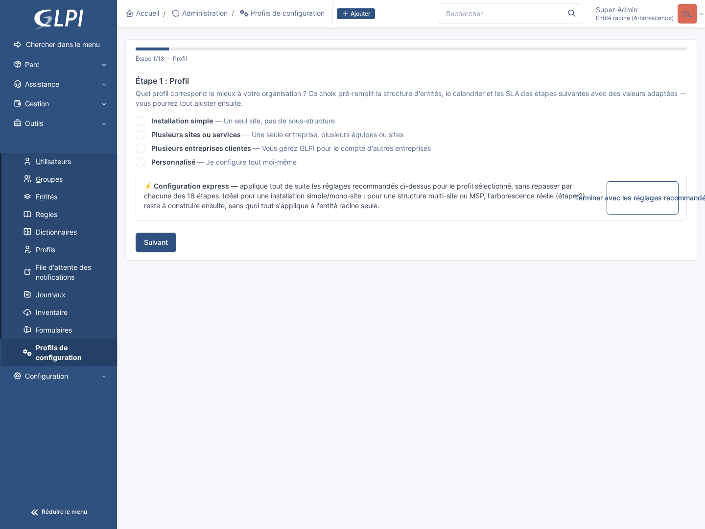
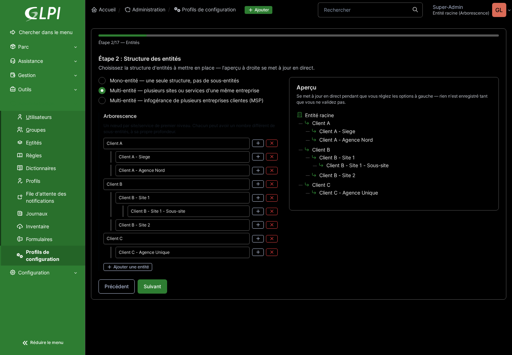

# Configuration GLPI Auto

[](https://www.gnu.org/licenses/gpl-3.0)
[](https://php.net)
[](https://glpi-project.org)
[](https://github.com/parime/Configuration-glpi-auto/actions)
[](https://github.com/parime/Configuration-glpi-auto/releases)

[🇫🇷 Français](README.md) | 🇬🇧 **English**

<p align="center"><strong>A brand-new GLPI instance, configured to ITIL/ISO 27001 best practices, in 19 guided steps instead of days of manual tweaking.</strong></p>

Configuration GLPI Auto is a GLPI plugin that aims to turn a blank installation into an operational platform in just a few clicks.

A fresh GLPI install is a blank page: no entities, no calendar, no SLAs, no ticket categories, no templates. Configuring all of that correctly by hand, while following ITIL best practices and ISO 27001 requirements, typically takes a newcomer administrator several days, with the risk of missing something important (SLA escalation, document classification, per-site rights...). This plugin condenses that work into a guided 20-step wizard: you answer questions about your organization, the wizard builds the matching configuration, and nothing is created in GLPI until you confirm the final summary.

> See [CHANGELOG.md](CHANGELOG.md) for the release history (the "Latest Release" badge above
> shows the most recent one) and [ROADMAP.md](ROADMAP.md) for what's planned.

📖 **[See the full tutorial](docs/TUTORIAL.md)**: all 19 wizard steps, one screenshot per step
(available in French and English).

## Where to start?

Pick your role: each guide is a few steps, with the exact menus ([all guides](docs/ROLES.en.md)).

| You are... | You want to... | Guide |
|---|---|---|
| GLPI administrator | Install the plugin and run the wizard (first configuration in 10 steps) | [GLPI administrator](docs/ROLES.en.md#glpi-administrator) |
| Asset manager | Statuses, locations, asset types, dictionaries, fleet checks | [Asset manager](docs/ROLES.en.md#asset-manager) |
| Helpdesk manager | Form catalog, SLAs, receiving tickets by email | [Helpdesk manager](docs/ROLES.en.md#helpdesk-manager) |
| Configuration auditor | Check the instance and follow up on gaps | [Configuration auditor](docs/ROLES.en.md#configuration-auditor) |

## Table of contents

- [Where to start?](#where-to-start)
- [What sets it apart](#what-sets-it-apart)
- [Screenshots](#screenshots)
- [Features](#features)
- [Requirements](#requirements)
- [Installation](#installation)
- [Usage](#usage)
- [Documentation](#documentation)
- [Contributing](#contributing)
- [License](#license)

## What sets it apart

- **Nothing is created until the end**: the 20 steps only build up a configuration in memory, with a live-updating preview (see screenshot below); you can go back, change anything, start over, without ever touching GLPI before confirming the final summary.
- **An express mode for the impatient**: a single click at step 1 applies the chosen profile's recommended settings directly, without going through the following 19 steps one by one: for a simple installation, an operational GLPI instance in a few seconds.
- **Built for multi-site and MSP from the start**: the same entity tree, the same SLAs and the same visual customization can be differentiated per site or per client, without juggling several separate GLPI installations.
- **ISO 27001 compliance built in**: knowledge base document topics and criticality levels are offered right in the wizard, not bolted on afterwards by digging through GLPI's documentation.
- **No orphaned data**: every setting the wizard proposes (categories, statuses, templates...) is immediately usable: the service catalog generated in step 7 already routes automatically to the right category created in step 6, for example.

## Screenshots

**The starting profile choice**: four predefined profiles pre-fill the following 19 steps with values suited to your organization, freely adjustable afterwards; an express mode applies the recommended settings directly without going through every step:



**The entity structure, with a live preview**: single-site, multi-site or MSP: the tree is built on the left, the preview on the right updates with every change, before anything is saved:



All other screenshots (all 20 steps in detail) are in the [tutorial](docs/TUTORIAL.md).

## Features

- A 20-step graphical wizard with a progress bar and an express mode (applies the recommended
  settings directly, without going through every step)
- 4 predefined profiles (Simple install, Multiple sites or departments, Multiple client companies
  / MSP, Custom) that pre-fill the following steps with values suited to each
- Entity structure (single-site, multi-site, or MSP) with a real-time preview
- Calendar, SLA/OLA with automatic escalation between support tiers (L1 -> L2 -> L3), fixed-date
  public holidays per country (dedicated calendar per country, France by default)
- Topic-based ticket categories (11 selectable branches, up to 3 levels) and a self-service
  catalog (native GLPI 11 and 12 forms, automatic routing to the right category, conditional
  sections and questions, urgency, device, observers and approval taken from the answers, forms
  updated without duplicates unless they were edited in GLPI)
- Asset statuses, additional project statuses and pending reasons with automatic follow-up/closure
- If the assetsign-glpi plugin is active: its form triggers (handover, return, donation, sale,
  destruction, decommissioning) linked to the created statuses, never changing an existing setting
- If the Docker Inventory plugin (0.7.0 or later) is active: a step declares its Portainer, WUD,
  Harbor and Kubernetes connections, each tested before saving (secret encrypted by that plugin
  with the GLPI key), with no automatic import and no change to an existing connection
- Receiving tickets by email: GLPI mail receivers created disabled (password encrypted by GLPI,
  never kept by the plugin), per-mailbox routing to an entity, a category and a group, refusal of
  automatic replies and delivery failures, connection test
- Visual customization: color and logo, native or custom GLPI palette, settings differentiated
  per client/site in MSP mode
- Ticket templates (simplified / full) automatically assigned based on the user's GLPI profile,
  LDAP rights (per site and per role/department)
- Libraries of task, solution, follow-up and validation templates, with dynamic Twig variables
  (real ticket/requester data), change and problem templates
- A library of ticket templates for common recurring tasks (user review, maintenance, updates) -
  ready-to-use content only, no automatic scheduling imposed
- Locations, manufacturers, knowledge base categories, document topics (ISO 27001 classification)
  and criticality levels, Projects module dropdowns
- Optional custom assets: Vehicle, Server, Building/Local (dedicated branches), Fire Safety & First
  Aid and Physical Security (aligned with ISO/IEC 27001 Annex A.7), each with its own compliance
  fields (verification dates, warranty...)
- Software license types, certificate types (SSL/TLS, code signing, S/MIME...) and database
  instance types, on top of standard equipment types (computers, monitors, network, peripherals,
  phones)
- Optional activation of GLPI's native inventory (FusionInventory/GLPI Agent)
- Configuration audit of the GLPI instance (default accounts, password policy, notifications,
  SLAs, statuses...) with one-click fixes when the right setting is unambiguous, continuous
  checking and a periodic email report (weekly or monthly, editable GLPI notification, no secret
  sent)
- Useful RSS feeds (CERT-FR security advisories, GLPI release notes) and plugin version tracking
  against the latest GitHub release
- Ticket import from Jira, from a CSV export or directly through the REST API (Jira Cloud or Data
  Center, token never stored): dry-run preview of status and type mappings, comments as
  follow-ups, original dates, re-import without duplicates, no notification sent
- Generic ticket import from a CSV file (another helpdesk tool, a spreadsheet): column mapping
  suggested from the headers and savable as a template (JSON export/import), dry-run preview with
  status, type, priority and category mappings, comments and attachments, re-import without
  duplicates by original identifier
- Interface translated into 6 languages (French, English, German, Italian, Spanish, Brazilian Portuguese)

## Requirements

- PHP 8.2+
- GLPI 11.0+ or GLPI 12 (one package for both versions, it adapts at load time)

On GLPI 12 (checked in CI on GLPI 12.0.1, on every PR):

- "knowledge base categories" become container articles under the root article (GLPI 12
  removed categories);
- each OLA is attached to the "Support N1" group (GLPI 12 requires a group per OLA);
- GLPI 12.0.1 or later recommended: on 12.0.0, the item picked in a form's "Item" question (vehicle,
  room, equipment) was not linked to the created ticket (GLPI core bug, glpi-project/glpi#25903, fixed
  in 12.0.1). GLPI 11 is not affected.
- Database: the one required by GLPI 11 (MySQL 8.0+ or MariaDB 10.6+); GLPI does not support
  PostgreSQL

## Installation

No Composer package (GLPI isn't distributed via Packagist). Two ways to get the plugin:

### Recommended: release archive (no Git or Composer required)

Ideal for a production GLPI instance, including a minimal Docker container.

1. Download `configuration-glpi-auto-X.Y.Z.zip` from
   [GitHub Releases](https://github.com/parime/Configuration-glpi-auto/releases) (the "Latest
   Release" badge at the top of this page links to the newest one).
2. Extract the archive into GLPI's `plugins/` folder:
   ```bash
   cd /path/to/glpi/plugins
   unzip configuration-glpi-auto-X.Y.Z.zip
   ```
   The archive already contains a `configurationglpiauto/` folder at its root, `vendor/` included
   (no `composer install` step needed on the target server), nothing to rename.
3. Install and activate it, either from the UI (**Configuration > Plugins**, search for
   "Configuration GLPI Auto") or from the command line:
   ```bash
   php bin/console plugin:install configurationglpiauto
   php bin/console plugin:activate configurationglpiauto
   ```

### From source (to contribute or develop)

`vendor/autoload.php` is a hard runtime requirement (PSR-4 autoloading for `src/`, see
`setup.php`), but the plugin has no real production dependency (`composer.json`: `php >= 8.2`
only), so `composer install --no-dev` is fast, nothing else gets downloaded.

```bash
cd /path/to/glpi/plugins
git clone https://github.com/parime/Configuration-glpi-auto.git
mv Configuration-glpi-auto configurationglpiauto
cd configurationglpiauto
composer install --no-dev
```

Then install/activate as above (UI or `bin/console`).

### Updating

An update is never signaled automatically (this plugin is outside the official Marketplace):
fetch the new code the same way you installed it (a new release ZIP, or `git pull` +
`composer install --no-dev` if installed from source), then re-run `plugin:install --force`
(database migration if needed) and `plugin:activate`.

### Docker test stack

A ready-to-use Docker stack (GLPI + MariaDB) for testing the plugin is provided in
`docker-compose.test.yml`: see the comments at the top of that file for the full walkthrough
(installing GLPI, installing the plugin, known permission/cache pitfalls).

## Usage

Once the plugin is active, the wizard is available from **Configuration > Configuration
profiles > Configuration**. Choose a starting profile (step 1), then go through the 20 steps,
adjusting each setting to your needs; nothing is created in GLPI before the last step (Summary).
Express mode (a button available from step 1) applies the chosen profile's recommended settings
directly, without going through every step. See the [tutorial](docs/TUTORIAL.md) for a screenshot
of each step.

## Documentation

Rules shared by all parime plugins, to read before contributing: [common plugin charter](https://github.com/parime/glpi-plugin-template/blob/main/CHARTE.md) (in French).

- [Guides by role](docs/ROLES.en.md): GLPI administrator, asset manager, helpdesk manager,
  configuration auditor.
- [Tutorial](docs/TUTORIAL.md): a step-by-step walkthrough of the wizard's 20 steps, with a
  screenshot of each.
- [ITIL Guide](docs/ITIL_GUIDE.md): why the wizard suggests what it suggests - which ITIL 4
  practice each step translates into concrete GLPI settings.
- [CHANGELOG.md](CHANGELOG.md) and [ROADMAP.md](ROADMAP.md) for the technical detail of each
  feature.

## Contributing

Contributions are welcome! Please read [CONTRIBUTING.md](CONTRIBUTING.md) for the guidelines.

## Translations

[](https://hosted.weblate.org/engage/configuration-glpi-auto/)

The plugin is translated into French, English, German, Spanish, Italian, Polish and Portuguese
(Brazil). **Translation contributions are welcome on [Hosted Weblate](https://hosted.weblate.org/engage/configuration-glpi-auto/)**: fixing a term,
improving domain vocabulary or adding a language is done directly in the browser, without Git.
Weblate then proposes the translations through a Pull Request, reviewed before being merged.

## Reuse and citation

This project is licensed under **GPL-3.0-or-later**. If you reuse code, even partially and without
forking the repository: keep the copyright headers and the [NOTICE](NOTICE) file, keep the same
licence with the source code, state your changes and credit the original project
(https://github.com/parime/Configuration-glpi-auto). To cite the project, see [CITATION.cff](CITATION.cff) (GitHub "Cite this repository"
button). Coding assistants will find these rules in [AGENTS.md](AGENTS.md).

## License

GPLv3 - See [LICENSE](LICENSE) for details.
