[🇫🇷 Français](#-français) · [🇬🇧 English](#-english)

## 🇫🇷 Français

**Tutoriel : Utilisation de l'assistant**

Configurer une instance GLPI neuve à la main (entités, calendrier, SLA, catégories, statuts,
modèles, droits, personnalisation) prend habituellement plusieurs jours à un administrateur qui
découvre l'outil, avec le risque d'oublier un réglage important en cours de route. Cet assistant
condense ce travail en 19 étapes guidées : vous répondez à des questions sur votre organisation,
il construit la configuration correspondante, et vous voyez le résultat avant qu'il ne soit
appliqué. Ce tutoriel parcourt chacune de ces 19 étapes, avec une capture d'écran de chacune, pour
que vous sachiez exactement à quoi vous attendre, même avant d'avoir installé le plugin.

Les captures ci-dessous montrent le profil **« Plusieurs sites ou services »** : les
autres profils (Installation simple, Plusieurs entreprises clientes/MSP, Personnalisé)
pré-remplissent les mêmes étapes différemment, mais la structure du parcours est identique.

À tout moment, vous pouvez revenir en arrière avec **Précédent** sans perdre vos réponses : rien
n'est enregistré dans GLPI avant le Récapitulatif (étape 20, ou 21 avec l'étape « Inventaire
Docker »), à une exception près : les connexions de l'étape « Inventaire Docker » s'enregistrent
dès que vous cliquez sur « Enregistrer la connexion ». Vous pouvez donc parcourir tout
l'assistant pour voir ce qu'il propose, sans risque, avant de décider de valider quoi que ce soit.

### Étape 1 : Profil

Le point de départ : quatre profils prédéfinis (PME/ETI mono-site, plusieurs sites ou services,
plusieurs entreprises clientes/MSP, ou personnalisé). Le choix pré-remplit la structure d'entités,
le calendrier et les SLA des étapes suivantes avec des valeurs adaptées ; tout reste ajustable
ensuite, aucun choix n'est définitif. Un bouton **mode express** permet aussi de valider directement
avec les valeurs par défaut du profil choisi, sans parcourir les 19 étapes une à une : pour une
installation simple, une instance opérationnelle en quelques secondes plutôt qu'en 18 étapes
supplémentaires.

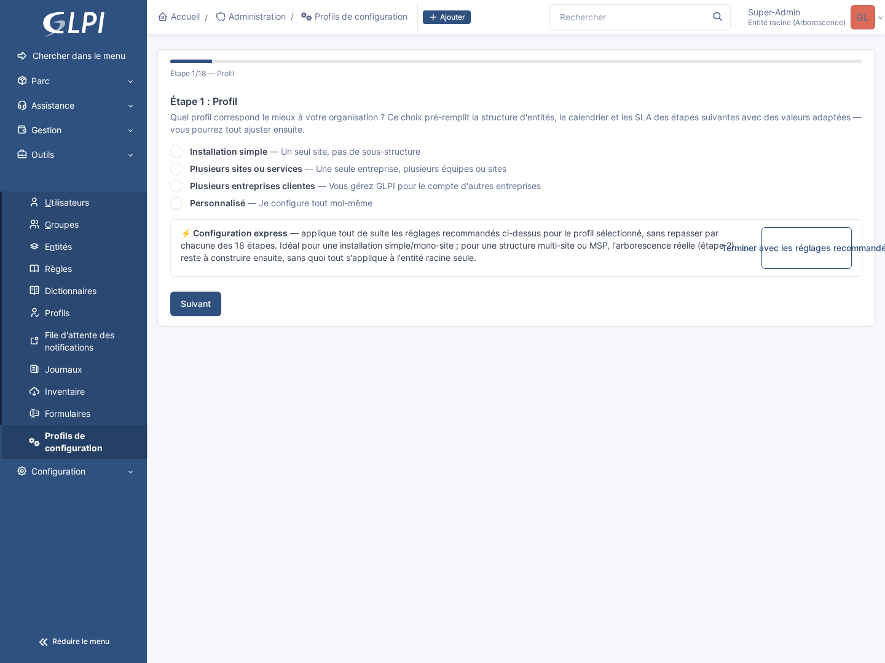

### Étape 2 : Entités

Construit l'arborescence d'entités : mono-entité, multi-site (une entreprise, plusieurs
sites/équipes), ou MSP (plusieurs entreprises clientes distinctes). Un nœud par site, profondeur
libre ; l'aperçu à droite se met à jour en direct à chaque ajout, sans rien enregistrer tant que
vous n'avez pas validé le récapitulatif final. C'est cette structure qui, plus tard, permettra de
différencier calendrier, SLA, logo ou droits par site ou par client, sans avoir à gérer plusieurs
instances GLPI séparées.

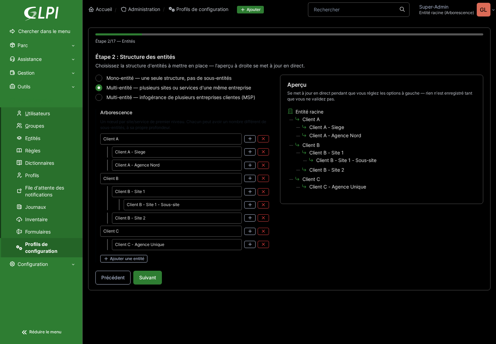

### Étape 3 : Lieux

Optionnel : associez une adresse (rue, ville, coordonnées GPS, alias, téléphone...) à n'importe
quelle entité de l'arborescence construite à l'étape précédente, à n'importe quelle profondeur.
Aucune adresse saisie, aucun lieu créé, comme sur une installation GLPI neuve. Un assistant
d'adresse optionnel (Nominatim/OpenStreetMap) propose des suggestions de rue pendant la saisie une
fois la ville et le pays renseignés, pour éviter les fautes de frappe qui rendraient une adresse
inexploitable sur une carte. Chaque entité peut aussi avoir des lieux enfants (bâtiment,
étage, salle...), et sa propre fiche adresse native GLPI (Entités > Adresse) peut être complétée en
même temps avec les mêmes coordonnées, plus téléphone/fax/site web/e-mail.

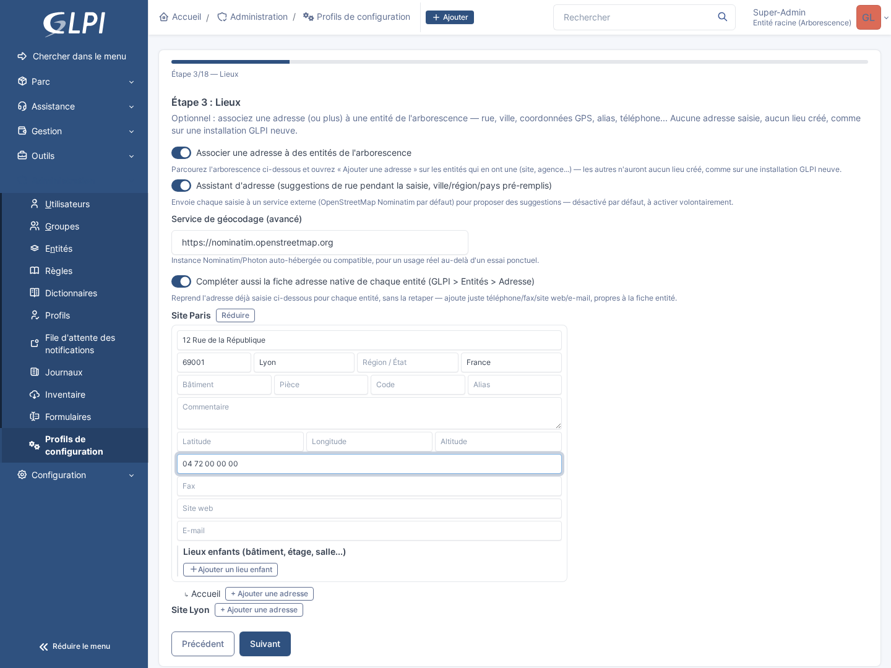

### Étape 4 : Calendrier

Horaires d'ouverture et jours fériés français, utilisés ensuite par les SLA pour calculer les
délais réels (hors horaires non ouvrés) : sans ce réglage, un SLA "résolution sous 4h" décompterait
aussi les nuits et les week-ends, ce qui n'aurait aucun sens opérationnel.

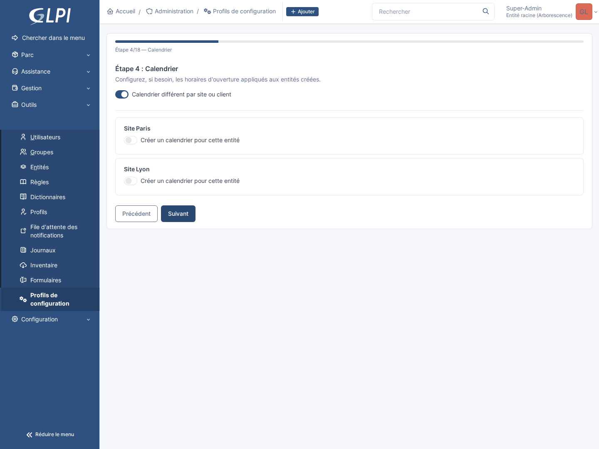

### Étape 5 : SLA

Seuils de résolution par priorité (SLA côté demandeur) et engagements internes (OLA), avec
escalade automatique N1 → N2 → N3 configurable : un ticket qui traîne remonte tout seul au niveau
de support supérieur avant que le délai ne soit dépassé, plutôt que de compter sur un technicien
qui surveille le tableau de bord en permanence.

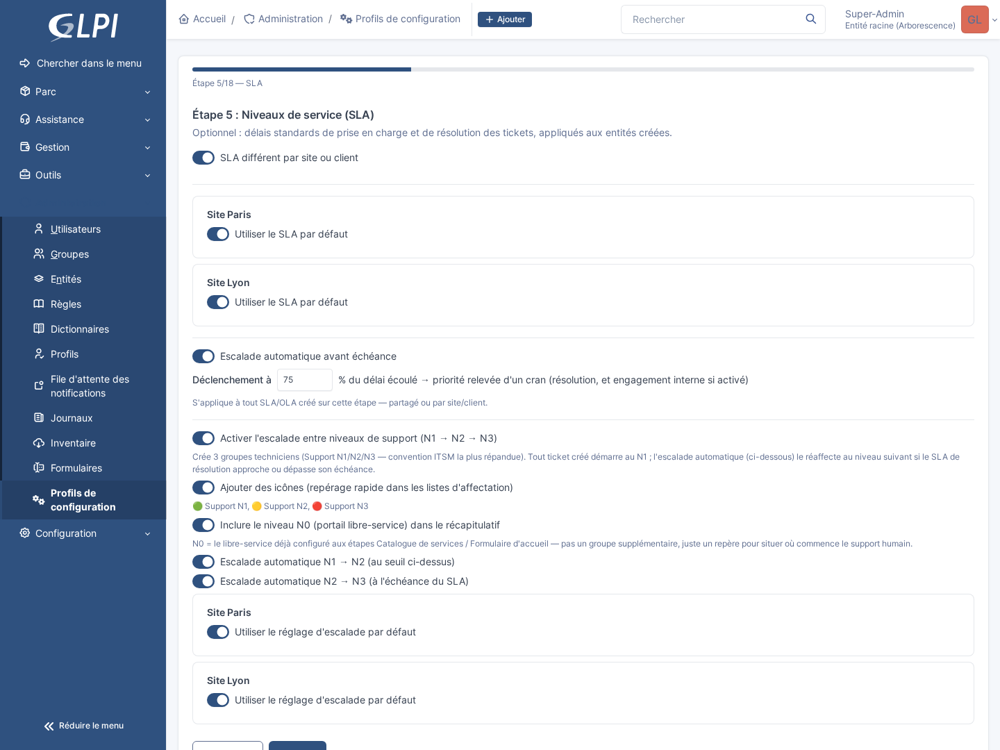

### Étape 6 : Catégories

Arborescence de catégories de tickets sur 3 niveaux, organisée par thème métier (IT, Bâtiment,
RH...). Chaque branche de premier niveau est sélectionnable indépendamment : une organisation sans
flotte automobile ou maintenance industrielle n'a pas à les garder, plutôt que de devoir supprimer
à la main des dizaines de catégories inutiles après coup.

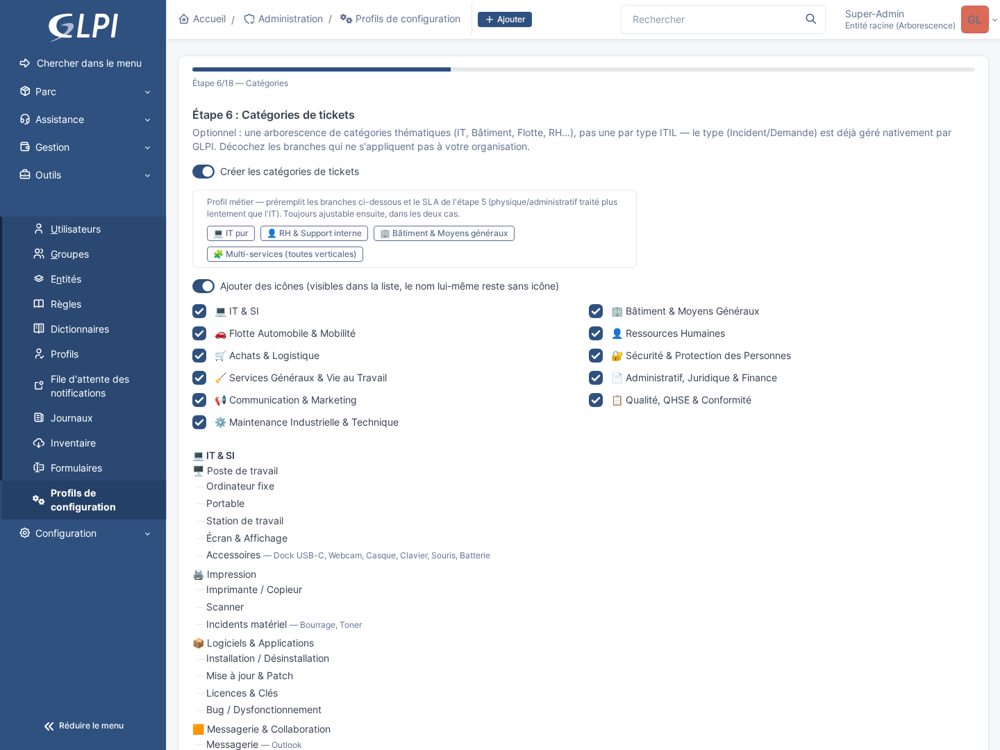

### Étape 7 : Catalogue de services

Génère un catalogue en libre-service (formulaires GLPI natifs) à partir des catégories
sélectionnées à l'étape précédente : chaque service route automatiquement vers la bonne catégorie,
sans que l'utilisateur final ait à la choisir lui-même : il décrit son besoin en langage courant
("mon écran ne s'allume plus"), pas en jargon de classification ITIL.

Les formulaires ne posent que les questions utiles : dans « Arrivée d'un nouveau collaborateur »,
le modèle de portable n'est demandé que si l'ordinateur portable est coché ; dans « Signaler un
e-mail suspect ou un incident de sécurité », les questions sur l'e-mail n'apparaissent que pour un
e-mail suspect, et une urgence haute demande qui est touché. Le ticket reprend les réponses :
urgence, lieu, appareil concerné, responsable en observateur, approbation du responsable désigné,
et même la catégorie quand elle dépend de ce qui est signalé.

Relancer l'assistant met à jour ces formulaires quand une nouvelle version du plugin les
améliore, sans créer de doublon. Un formulaire que vous avez modifié dans GLPI (question
renommée, destination ajustée...) n'est plus jamais modifié par l'assistant.

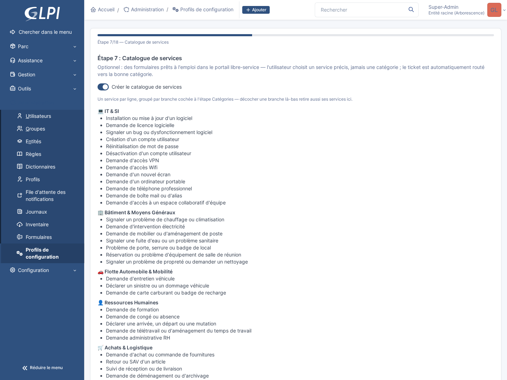

### Étape 8 : Statuts

Statuts d'éléments du parc (En stock, Affecté, En panne...), avec sélection individuelle de ceux à
créer : la base d'un inventaire exploitable, où chaque matériel a un état clair plutôt qu'une
colonne vide.

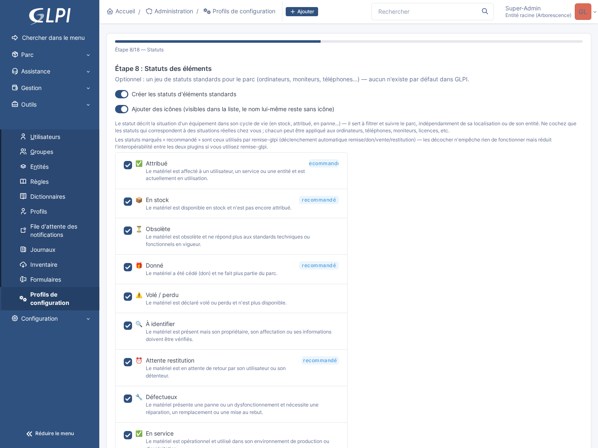

### Étape 9 : Raisons d'attente

Raisons de mise en attente d'un ticket, chacune pouvant déclencher automatiquement un modèle de
suivi et une fréquence de relance : un ticket "en attente de pièce" relance le demandeur tout seul
au bon rythme, sans qu'un technicien n'ait à s'en souvenir.

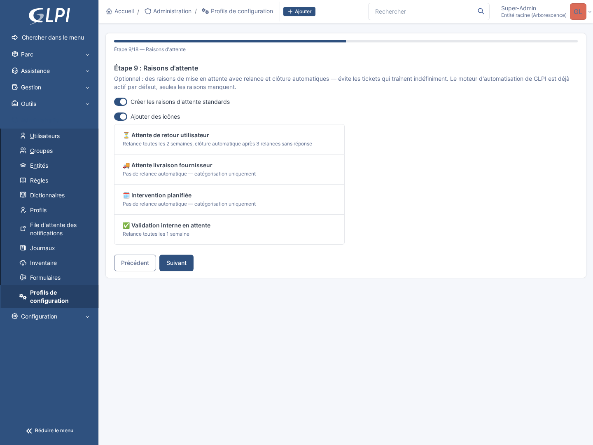

### Étape 10 : Modèles de tickets

Deux modèles de ticket assignés automatiquement selon le profil GLPI de l'utilisateur : un
simplifié (titre + description) pour les profils de base, un complet (catégorie et urgence
obligatoires) pour le personnel technique ; chacun voit un formulaire adapté à son niveau, sans
configuration supplémentaire.

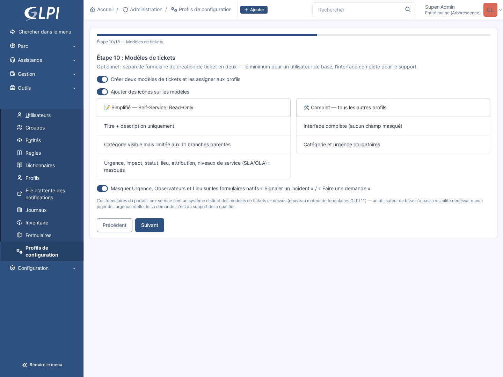

### Étape 11 : Tâches & solutions

Bibliothèque de gabarits de tâches et de solutions réutilisables, classés par type (assistance,
résolution technique, sécurité, gestion des accès...), avec une salutation personnalisée générée
dynamiquement à partir du demandeur réel du ticket : un technicien insère un gabarit et obtient
un texte déjà personnalisé, pas un texte générique à retoucher à la main à chaque fois.

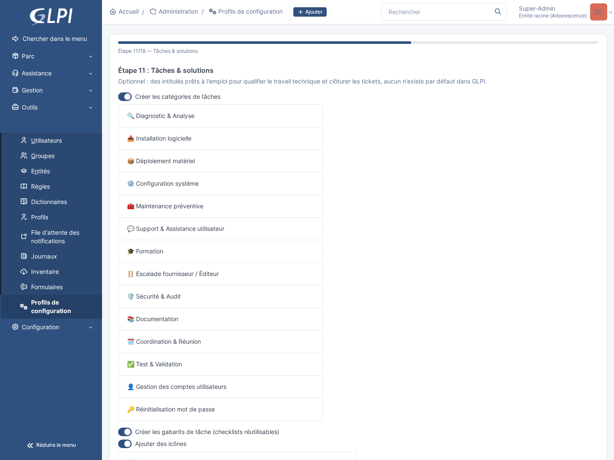

### Étape 12 : Suivis, validations & modèles

Gabarits de suivis (messages de relance/notification réutilisables), étapes de validation
(hiérarchique, technique, comité...), et modèles de changement/problème : de quoi couvrir les
processus ITIL Change/Problem Management dès le premier jour, sans les construire de zéro.

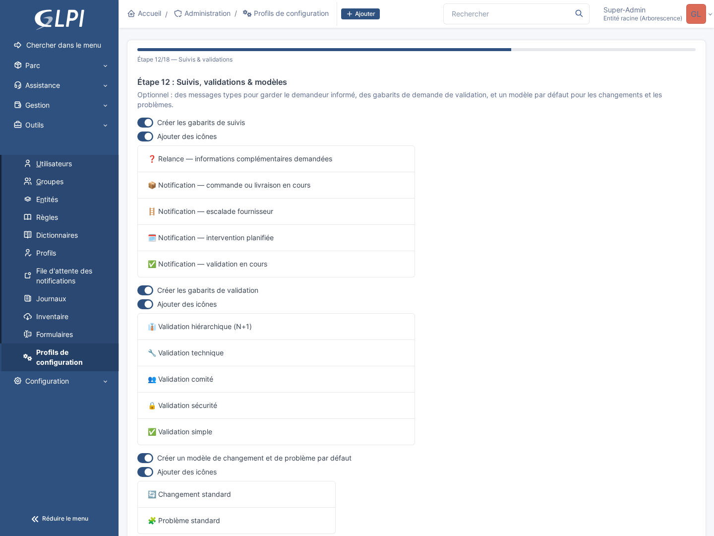

### Étape 13 : Droits LDAP par entité

Optionnel : règles d'affectation automatique entité + profil par site lors d'une synchronisation
LDAP/AD, plus des règles par fonction/département indépendantes du site (ex. le groupe AD
« Finance » reçoit toujours tel profil, quel que soit le site de l'utilisateur) : un nouvel
utilisateur synchronisé depuis l'annuaire arrive déjà au bon endroit avec les bons droits, sans
intervention manuelle d'un administrateur GLPI.

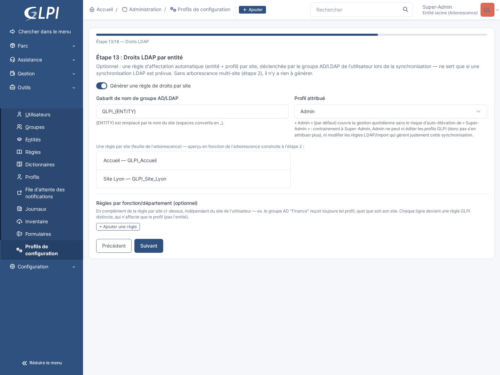

### Étape 14 : Réglages généraux GLPI

Bascule des paramètres GLPI natifs recommandés : notifications, tâches automatiques, champs
masqués sur les formulaires en libre-service... des réglages que la documentation officielle de
GLPI recommande, mais qu'il faut connaître et retrouver un par un dans un menu par ailleurs très
dense.

**Double authentification** (GLPI 11 et plus) : le bloc « Double authentification » propose de
cocher la case native « Forcer 2FA » (onglet « Sécurité » du profil) sur les profils de l'interface
standard. Super-Admin, Admin et Technicien sont pré-cochés, mais la case principale reste
décochée : rien ne change tant que vous ne l'activez pas. Chaque profil indique si l'obligation est
déjà en place et combien de ses comptes n'ont pas d'application d'authentification. Chaque personne
configure son application à sa prochaine connexion ; décocher un profil ne retire jamais une
obligation existante (onglet « Sécurité » du profil). L'audit de configuration
liste les comptes à privilèges sans double authentification.

**Revue des comptes à privilèges** : l'audit de configuration signale aussi plus de 3 comptes
Super-Admin, les comptes de l'interface standard sans connexion depuis plus de 90 jours, ceux qui
ne se sont jamais connectés (créés depuis plus de 30 jours) et, quand un annuaire LDAP est actif,
plus d'un compte local à privilèges (un compte local de secours reste normal). Chaque compte est
un lien vers sa fiche ; rien n'est désactivé automatiquement.

**Fin de support des systèmes et du matériel** (facultatif) : dans Audit de configuration, carte
« Fin de support des systèmes et du matériel », cochez « Activer le contrôle de fin de support »,
puis cliquez sur « Proposer les correspondances » : chaque système d'exploitation reconnu du parc
reçoit une ligne « Nom dans GLPI = produit » (par exemple `Debian GNU/Linux = debian`). Vérifiez
ces lignes, ajoutez vos modèles de matériel (`iPhone 12 = iphone 12`), enregistrez, puis cliquez
sur « Télécharger les dates » : seul le site endoflife.date est contacté, et seulement à ce
moment-là. Les dates restent en base ; l'audit signale ensuite le matériel en service hors
support ou qui le sera dans le délai choisi (180 jours par défaut). Sans accès à Internet, cochez
le mode hors ligne et importez le fichier JSON d'un produit récupéré sur un autre poste.
« Créer les tickets » ouvre un ticket lié au matériel concerné ; rien n'est modifié sur le
matériel.

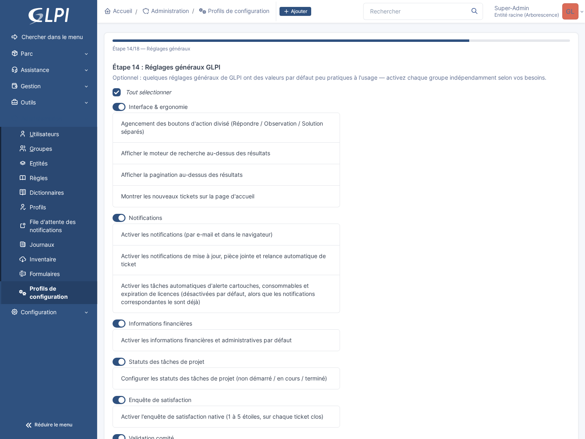

### Étape 15 : Général & Outils

Intitulés transverses : fabricants, sources de demande, catégories d'utilisateurs, catégories de
la base de connaissances, rubriques documentaires (classification ISO 27001), évènements de
planning : le socle d'intitulés dont dépendent presque tous les autres modules de GLPI.

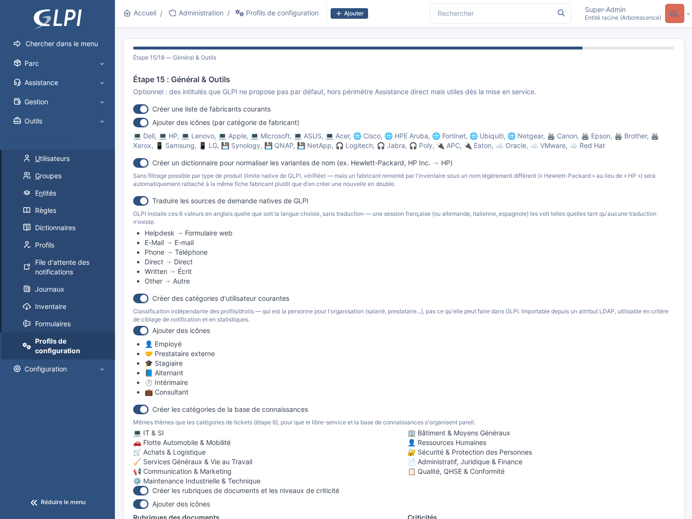

### Étape 16 : Projets

Types de projet et de tâche de projet, gabarits de tâches de projet, modèles de projet, catégories
et gabarits d'évènements de planning : pour piloter des projets internes (déploiement, migration...)
depuis GLPI plutôt que dans un tableur séparé.

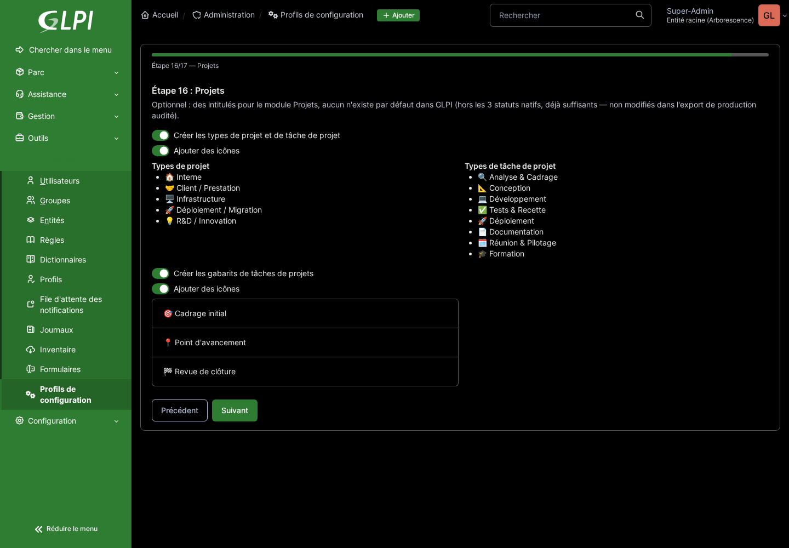

### Étape 17 : Personnalisation graphique

Couleur principale et logo, appliqués à l'interface GLPI : partagés pour toute l'instance ou
différenciés par client/site en mode multi-entité, pour qu'un client MSP reconnaisse ses propres
couleurs plutôt que celles d'un concurrent hébergé sur la même instance. Aperçu en direct de l'en-tête
GLPI pendant le réglage. Placée en dernier dans le parcours : c'est la partie la moins importante,
purement esthétique, qui ne doit pas retarder les réglages fonctionnels qui précèdent.

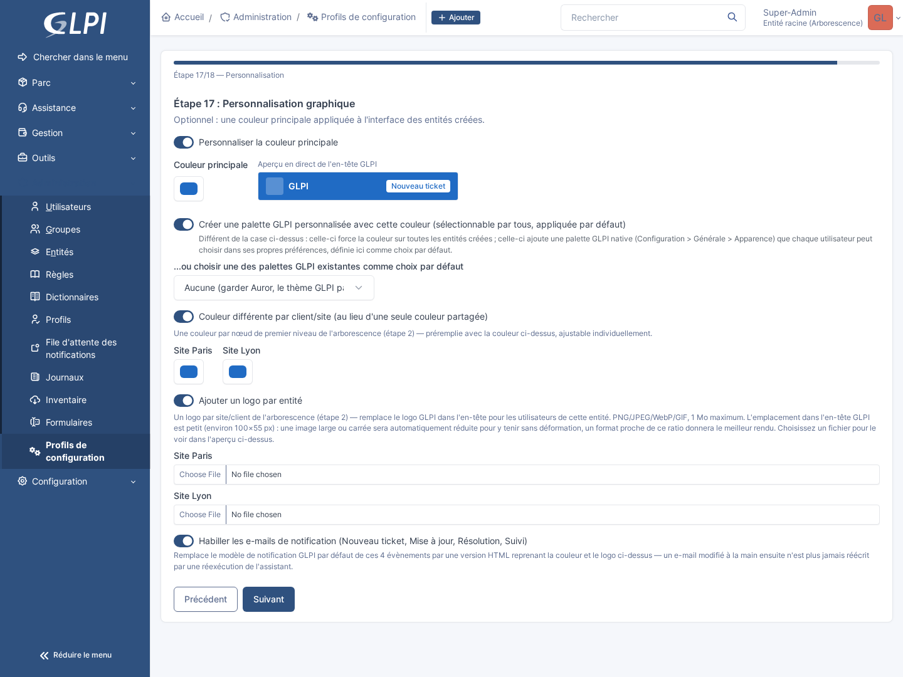

### Étape 18 : Configuration SMTP

Optionnel : révise directement les réglages d'envoi d'e-mail natifs de GLPI (serveur, port,
adresse d'expédition, identifiants, vérification du certificat TLS) : jamais une copie propre à ce
plugin, ces réglages sont écrits directement dans la configuration GLPI native. Le mot de passe
n'est jamais pré-rempli ni renvoyé au navigateur, même s'il y en a déjà un enregistré. Le test de
connexion se fait après avoir terminé l'assistant, depuis l'écran natif GLPI (Configuration >
Notifications) : GLPI n'y teste que la configuration réellement enregistrée, jamais un formulaire
en cours de saisie.

*(Capture d'écran à venir.)*

### Étape 19 : Réception des tickets par e-mail

Optionnel : GLPI relève une ou plusieurs boîtes aux lettres (par exemple support@ et
facturation@) et transforme chaque nouveau message en ticket ; une réponse à un ticket existant
devient un suivi de ce ticket. Pour chaque boîte : adresse, serveur, protocole (IMAP ou POP3),
sécurité et port, identifiant, mot de passe (facultatif, transmis à GLPI qui le chiffre, jamais
conservé par l'assistant ni exporté avec un profil), dossiers de rangement des messages traités et
refusés (IMAP), taille maximale des pièces jointes, et où ranger les tickets : entité, catégorie,
groupe en charge.

- Chaque boîte devient un collecteur GLPI (Configuration > Collecteurs) **créé désactivé** tant que
  « Activer la relève dès maintenant » n'est pas cochée ; relancer l'assistant met à jour la boîte
  de même adresse, sans doublon, et ne désactive jamais un collecteur déjà actif.
- L'entité se règle par une règle de collecteur (Administration > Règles > Règles d'affectation
  d'un ticket ouvert via un collecteur de courriels), la catégorie et le groupe par une règle
  métier des tickets : toutes restent visibles et modifiables dans GLPI.
- « Refuser les réponses automatiques » (recommandé) active les règles natives de GLPI
  (notifications de GLPI, en-tête Auto-Submitted) et ajoute le refus des messages d'absence et des
  erreurs de distribution (mailer-daemon, postmaster), sans réponse, pour éviter les boucles. En
  option : l'en-tête X-Auto-Response-Suppress, et le refus des expéditeurs hors des domaines
  autorisés.
- Les collecteurs déjà enregistrés s'affichent avec un bouton **Tester la connexion** : GLPI se
  connecte avec les réglages enregistrés et compte les messages, sans en relever ni en déplacer.

L'audit de configuration signale ensuite un collecteur en erreur, l'absence de règle d'entité
(chaque message serait refusé) et les risques de boucle (boîte relevée qui est aussi une adresse
d'envoi de GLPI, règles natives de refus désactivées).

### Étape 20 : Inventaire Docker (si le plugin est installé)

Cette étape n'apparaît que si le plugin **Inventaire Docker** (`dockerinventory`, version 0.7.0 ou
plus) est installé et actif. Elle déclare les sources qu'il lit, sans passer par ses écrans :

- **Portainer** : adresse et jeton d'accès d'un compte dédié. Un encadré rappelle les limites de
  Portainer CE : il n'a pas de rôle en lecture seule, et un utilisateur standard ne voit que les
  ressources en accès « Public » ou attribuées à son équipe.
- **What's Up Docker (WUD)** : adresse, et compte au rôle `ro` (lecture seule) si WUD demande une
  authentification.
- **Harbor** : adresse, compte robot en lecture (pull), hôte dans les images s'il diffère, et
  **registres maîtrisés** (hôtes d'où les images déployées doivent venir), enregistrés par leur
  propre bouton.
- **Kubernetes** (avec Inventaire Docker 0.8.0) : adresse de l'API (HTTPS), jeton d'un compte de
  service en lecture seule, certificat d'autorité si le cluster a la sienne.

Pour chaque source, **Tester la connexion** interroge le serveur sans rien enregistrer et affiche
le résultat tel quel : vert si tout va bien, orange pour un avertissement (par exemple un compte
Portainer qui ne voit aucun conteneur), rouge en cas d'échec. **Enregistrer la connexion** refait
ce test, puis crée la connexion dans Inventaire Docker s'il a réussi, même avec un avertissement.
Le jeton ou le mot de passe est chiffré par Inventaire Docker avec la clé de GLPI ; il n'est jamais
réaffiché. Une connexion qui existe déjà pour la même adresse n'est jamais modifiée : ouvrez-la
dans Inventaire Docker pour la changer.

Rien n'est importé automatiquement : le bouton **Lancer un premier import** ouvre la connexion (ou
la page des connexions) dans Inventaire Docker, où le bouton « Importer maintenant » lance la
première lecture. Les imports suivants tournent ensuite tout seuls.

L'étape demande le droit « Configuration » de GLPI en modification, celui qu'Inventaire Docker
exige pour créer une connexion. Sans lui, elle l'indique et ne propose aucun formulaire.

### Étape 20 ou 21 : Récapitulatif

Dernière étape avant la création réelle : relit tous les choix des 19 étapes précédentes. Rien
n'est créé dans GLPI avant de valider ici : c'est le tout premier moment de tout le parcours où
quelque chose est réellement écrit en base.

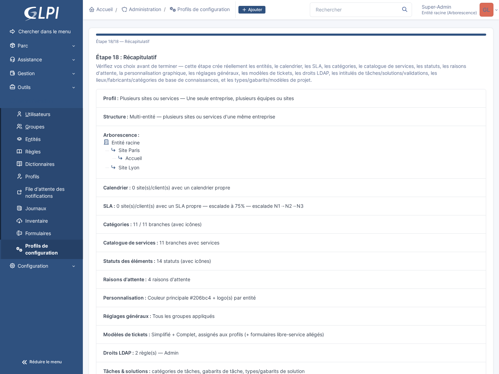

### Et ensuite ?

Une fois le récapitulatif validé, l'instance GLPI est immédiatement opérationnelle : entités,
calendrier, SLA, catégories, catalogue de services, statuts, modèles et droits sont en place et
utilisables dès la prochaine connexion ; pas besoin de redémarrer GLPI ni d'attendre une tâche
planifiée. Vous pouvez relancer l'assistant à tout moment (par exemple pour ajouter un nouveau
site ou ajuster un SLA) : les réglages déjà en place ne sont pas dupliqués, seuls les éléments
manquants sont créés.

**Note de durcissement** : en haut de l'audit de configuration, une note en pourcentage résume
les contrôles applicables, globalement et par domaine (vert à partir de 80, orange de 50 à 79,
rouge en dessous). Les contrôles de sécurité pèsent 3, ceux d'exploitation 2, ceux de qualité des
données 1 ; un contrôle à surveiller rapporte la moitié de son poids, un contrôle critique rien.
Une photo par jour est gardée dans l'historique : choisissez deux audits pour voir les contrôles
améliorés, dégradés, nouveaux ou retirés, par exemple avant et après un chantier de durcissement.
La note ne corrige rien.

**Écarts avec le Blueprint appliqué** : quelqu'un a changé un délai de SLA, une plage du calendrier
ou supprimé une catégorie à la main ? La section « Écarts avec le dernier Blueprint appliqué » de
l'audit compare ce que l'assistant a créé (SLA et OLA du « SLA standard », calendrier partagé,
branches de catégories, statuts) à ce qui existe aujourd'hui, avec un badge Ajouté, Modifié ou
Supprimé, la valeur dans GLPI et celle du Blueprint. Rien n'est modifié : si le changement était
voulu, reportez la valeur dans l'assistant ; sinon, « Réappliquer le Blueprint » ouvre l'écran de
déploiement, qui rappelle les écarts et propose de réaligner les SLA existants avant de confirmer.

Pour le détail technique de chaque fonctionnalité (ce qui est généré, pourquoi, et les décisions
prises en cours de route), voir [CHANGELOG.md](../CHANGELOG.md) et [ROADMAP.md](../ROADMAP.md).

## 🇬🇧 English

**Tutorial: Using the wizard**

Configuring a fresh GLPI instance by hand (entities, calendar, SLAs, categories, statuses,
templates, rights, customization) usually takes a newcomer administrator several days, with the
risk of missing something important along the way. This wizard condenses that work into 18 guided
steps: you answer questions about your organization, it builds the matching configuration, and you
see the result before it's applied. This tutorial walks through each of these 19 steps, with a
screenshot of each, so you know exactly what to expect, even before installing the plugin.

The screenshots below show the **"Multiple sites or departments"** profile: the other profiles
(Simple install, Multiple client companies/MSP, Custom) pre-fill the same steps differently, but
the flow's structure is identical.

At any point, you can go back with **Previous** without losing your answers: nothing is saved to
GLPI before step 18 (Summary). So you can go through the whole wizard to see what it proposes, risk
free, before deciding to confirm anything.

### Step 1 : Profile

The starting point: four predefined profiles (single-site SMB, multiple sites or departments,
multiple client companies/MSP, or custom). The choice pre-fills the entity structure, calendar and
SLAs of the following steps with values suited to it; everything remains adjustable afterwards,
no choice is final. An **express mode** button also lets you confirm directly with the chosen
profile's default values, without going through all 19 steps one by one: for a simple install, an
operational instance in a few seconds rather than 17 more steps.

### Step 2 : Entities

Builds the entity tree: single entity, multi-site (one company, several sites/teams), or MSP
(several distinct client companies). One node per site, unlimited depth; the preview on the right
updates live with every addition, with nothing saved until you confirm the final summary. It's this
structure that later lets you differentiate the calendar, SLAs, logo or rights per site or per
client, without having to manage several separate GLPI instances.

### Step 3 : Locations

Optional: attach an address (street, city, GPS coordinates, alias, phone...) to any entity in the
tree built in the previous step, at any depth. No address entered, no location created, same as
on a fresh GLPI install. An optional address helper (Nominatim/OpenStreetMap) suggests streets as
you type once the city and country are filled in, to avoid typos that would make an address
unusable on a map. Each entity can also have child locations (building, floor, room...), and its
own native GLPI address record (Entities > Address) can be filled in at the same time with the same
details, plus phone/fax/website/e-mail.

### Step 4 : Calendar

Business hours and French public holidays, used afterwards by the SLAs to compute real deadlines
(excluding non-working hours): without this setting, a "resolve within 4h" SLA would also count
nights and weekends, which would make no operational sense.

### Step 5 : SLA

Resolution thresholds per priority (requester-side SLA) and internal commitments (OLA), with
configurable automatic L1 → L2 → L3 escalation: a ticket that's stalling escalates itself to the
next support tier before the deadline is missed, rather than relying on a technician watching the
dashboard constantly.

### Step 6 : Categories

A 3-level ticket category tree, organized by business topic (IT, Facilities, HR...). Each
top-level branch can be selected independently: an organization with no vehicle fleet or
industrial maintenance doesn't have to keep those, rather than having to manually delete dozens of
unused categories afterwards.

### Step 7 : Service catalog

Generates a self-service catalog (native GLPI forms) from the categories selected in the previous
step: each service automatically routes to the right category, with no need for the end user to
choose it themselves: they describe their need in plain language ("my monitor won't turn on"),
not in ITIL classification jargon.

### Step 8 : Statuses

Asset statuses (In stock, Assigned, Out of order...), with individual selection of which ones to
create: the basis of a usable inventory, where every asset has a clear status rather than an
empty column.

### Step 9 : Pending reasons

Reasons for putting a ticket on hold, each able to automatically trigger a follow-up template and
a reminder frequency: a ticket "waiting for a part" follows up with the requester on its own, at
the right pace, with no technician having to remember to do it.

### Step 10 : Ticket templates

Two ticket templates automatically assigned based on the user's GLPI profile: a simplified one
(title + description) for basic profiles, a full one (category and urgency mandatory) for
technical staff; everyone sees a form suited to their level, with no extra configuration.

### Step 11 : Tasks & solutions

A library of reusable task and solution templates, classified by type (support, technical
resolution, security, access management...), with a personalized greeting dynamically generated
from the ticket's actual requester: a technician inserts a template and gets text that's already
personalized, not generic text to rework by hand every time.

### Step 12 : Follow-ups, validations & templates

Follow-up templates (reusable reminder/notification messages), validation steps (hierarchical,
technical, committee...), and change/problem templates: enough to cover ITIL Change/Problem
Management processes from day one, without building them from scratch.

### Step 13 : LDAP rights per entity

Optional: rules for automatically assigning an entity + profile per site during an LDAP/AD sync,
plus site-independent rules per role/department (e.g. the AD "Finance" group always gets a given
profile, regardless of the user's site): a new user synced from the directory already lands in
the right place with the right rights, with no manual intervention from a GLPI administrator.

### Step 14 : General GLPI settings

Toggling of recommended native GLPI settings: notifications, automatic actions, fields hidden on
self-service forms... settings that GLPI's own official documentation recommends, but that you'd
otherwise have to know about and find one by one in an already very dense menu.

**Two-factor authentication** (GLPI 11 and later): the "Two-factor authentication" block offers
to tick GLPI's native "Enforce 2FA" box (profile's "Security" tab) on standard interface profiles.
Super-Admin, Admin and Technician are pre-selected, but the main switch stays off: nothing changes
until you turn it on. Each profile shows whether it is already required and how many of its
accounts have no authenticator app. Each person sets up their app at their next login; unticking a
profile never removes an existing obligation (use the profile's "Security" tab).
The configuration audit lists privileged accounts that have no two-factor authentication.

**Privileged account review**: the configuration audit also reports more than 3 Super-Admin
accounts, standard interface accounts with no login for more than 90 days, accounts that never
logged in (created more than 30 days ago) and, when an LDAP directory is active, more than one
local privileged account (one local emergency account is normal). Each account links to its form;
nothing is deactivated automatically.

**End of support for systems and hardware** (optional): in Configuration audit, card "End of
support for systems and hardware", tick "Enable the end-of-support check", then click "Suggest
mappings": each recognised operating system of the fleet gets a line "Name in GLPI = product"
(for example `Debian GNU/Linux = debian`). Check these lines, add your hardware models
(`iPhone 12 = iphone 12`), save, then click "Download dates": only the endoflife.date site is
contacted, and only at that moment. The dates are kept in the database; the audit then reports
in-service hardware that is out of support or will be within the chosen delay (180 days by
default). Without Internet access, tick offline mode and import a product's JSON file fetched on
another computer. "Create tickets" opens a ticket linked to the hardware concerned; nothing is
changed on the hardware.

### Step 15 : General & Tools

Cross-cutting dropdowns: manufacturers, request sources, user categories, knowledge base
categories, document topics (ISO 27001 classification), calendar events: the base set of
dropdowns that almost every other GLPI module depends on.

### Step 16 : Projects

Project and project task types, project task templates, project templates, calendar event
categories and templates: for running internal projects (rollout, migration...) from GLPI rather
than in a separate spreadsheet.

### Step 17 : Visual customization

Primary color and logo, applied to the GLPI interface: shared across the whole instance or
differentiated per client/site in multi-entity mode, so an MSP client recognizes their own colors
rather than a competitor's hosted on the same instance. Live preview of the GLPI header while
adjusting it. Placed last in the flow: this is the least important part, purely cosmetic, and it
shouldn't delay the functional settings that come before it.

### Step 18 : SMTP configuration

Optional: review GLPI's native mail-sending settings directly (server, port, sender address,
credentials, TLS certificate verification): never a copy specific to this plugin, these settings
are written directly into GLPI's native configuration. The password is never pre-filled or sent
back to the browser, even if one is already saved. The connection test happens after finishing the
wizard, from GLPI's native screen (Setup > Notifications): GLPI only ever tests the configuration
actually saved there, never a form still being filled in.

*(Screenshot coming soon.)*

### Docker Inventory step (if the plugin is installed)

This step only appears when the **Docker Inventory** plugin (`dockerinventory`, 0.7.0 or later)
is installed and active, just before the summary. It declares the sources that plugin reads:
Portainer (address and access token, with a reminder of Portainer CE limits: no read-only role),
What's Up Docker (address, account with the `ro` role), Harbor (address, read-only robot account,
managed registries) and, with Docker Inventory 0.8.0, Kubernetes (API address, service account
token, certificate authority). **Test the connection** checks each source without saving anything
and shows the result as is: a warning stays a warning. **Save the connection** runs the same test,
then creates the connection in Docker Inventory, which encrypts the secret with the GLPI key; it is
never shown again. An existing connection with the same address is never changed. Nothing is
imported automatically: **Run a first import** opens the plugin page. Requires the GLPI
"Setup" right with update, the one Docker Inventory requires to create a connection.

### Step 19 : Summary

The last step before actual creation: reviews every choice made in the previous 18 steps. Nothing
is created in GLPI before confirming here: this is the very first moment in the whole flow where
anything is actually written to the database.

### What happens next?

Once the summary is confirmed, the GLPI instance is immediately operational: entities, calendar,
SLAs, categories, service catalog, statuses, templates and rights are in place and usable from the
next login; no need to restart GLPI or wait for a scheduled task. You can re-run the wizard at
any time (for example to add a new site or adjust an SLA): settings already in place aren't
duplicated, only missing elements are created.

**Hardening score**: at the top of the configuration audit, a percentage sums up the applicable
controls, overall and per domain (green from 80, orange from 50 to 79, red below). Security controls
weigh 3, operations controls 2, data quality controls 1; a control to watch earns half its weight, a
critical control nothing. One snapshot per day is kept in the history: pick two audits to see the
controls that improved, got worse, are new or were removed, for example before and after a hardening
project. The score never fixes anything.

**Drift from the applied Blueprint**: someone changed an SLA delay or a calendar range, or deleted a
category by hand? The "Differences from the last applied Blueprint" section of the audit compares
what the wizard created (SLAs and OLAs of the "SLA standard", shared calendar, category branches,
statuses) with what exists today, with an Added, Modified or Removed badge, the value in GLPI and
the one in the Blueprint. Nothing is changed: if the change was intended, copy the value into the
wizard; otherwise "Reapply the Blueprint" opens the deployment screen, which lists the differences
and offers to realign the existing SLAs before you confirm.

For the technical detail of each feature (what gets generated, why, and the decisions made along
the way), see [CHANGELOG.md](../CHANGELOG.md) and [ROADMAP.md](../ROADMAP.md).
